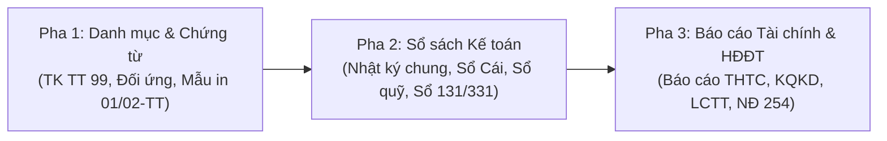

# Nghiên cứu và Thiết kế Module Kế toán Doanh nghiệp Việt Nam (Odoo 20)

> **Tài liệu tham chiếu:**
> - Triết lý và quy tắc ra quyết định: [odoo-module-playbook.md](odoo-module-playbook.md)
> - Quy trình lập trình, kiểm thử và môi trường: [odoo-dev-workflow.md](odoo-dev-workflow.md)
> - Danh mục module công ty hiện hữu: [custom-modules.md](custom-modules.md)

---

## 1. Mục tiêu và Phạm vi

Tài liệu này tổng hợp toàn bộ căn cứ pháp lý mới nhất về kế toán, thuế và hóa đơn điện tử tại Việt Nam (áp dụng từ năm tài chính 2026), đối chiếu với core Odoo 20 (`l10n_vn`), và đặc tả thiết kế kỹ thuật cho module **Kế toán Doanh nghiệp Việt Nam** (`company_accounting_vn`).

Mục tiêu là xây dựng một module chuẩn hóa, bền vững, **tuyệt đối không sửa core Odoo**, kế thừa tối đa và giải quyết triệt để các đặc thù của kế toán Việt Nam:
1. Tuân thủ **Thông tư 99/2025/TT-BTC** (chế độ kế toán mới thay thế Thông tư 200).
2. Xử lý bài toán **Tài khoản đối ứng (Nợ TK / Có TK)** trên kiến trúc bút toán đa dòng của Odoo.
3. Xuất trọn bộ **Mẫu biểu chứng từ in ấn**, **Hệ thống sổ kế toán**, và **Báo cáo tài chính**.
4. Sẵn sàng tích hợp **Hóa đơn điện tử theo Nghị định 254/2026/NĐ-CP**.

---

## 2. Khung pháp lý kế toán & thuế Việt Nam mới nhất

### 2.1. Chế độ kế toán doanh nghiệp: Thông tư 99/2025/TT-BTC

* **Ban hành:** Ngày 27/10/2025 bởi Bộ Tài chính.
* **Hiệu lực:** Từ ngày **01/01/2026**, áp dụng cho năm tài chính bắt đầu từ hoặc sau ngày này.
* **Bãi bỏ:** Chính thức thay thế hoàn toàn **Thông tư số 200/2014/TT-BTC** và **Thông tư số 75/2015/TT-BTC**.
* *(Lưu ý: Doanh nghiệp nhỏ và vừa áp dụng Thông tư 133/2016/TT-BTC vẫn được duy trì hoặc có thể đăng ký áp dụng Thông tư 99 nếu đáp ứng điều kiện).*

#### Các thay đổi trọng tâm của Thông tư 99:
1. **Tái cấu trúc Hệ thống tài khoản (Phụ lục II):**
   * Gồm **71 tài khoản cấp 1** phân chia theo 9 loại (Loại 1 đến 9).
   * **Bãi bỏ các tài khoản không còn phù hợp:**
     * TK 161 (Chi sự nghiệp)
     * TK 417 (Quỹ hỗ trợ sắp xếp doanh nghiệp)
     * TK 441 (Nguồn vốn đầu tư xây dựng cơ bản)
     * TK 461, 466 (Nguồn kinh phí sự nghiệp và nguồn kinh phí đã hình thành TSCĐ)
     * TK 611 (Mua hàng - theo phương pháp kiểm kê định kỳ)
     * TK 631 (Giá thành sản xuất - theo phương pháp kiểm kê định kỳ)
   * **Bổ sung và chi tiết hóa tài khoản mới:**
     * **TK 215:** Tài sản sinh học (nông nghiệp, chăn nuôi, trồng trọt quy mô lớn).
     * **TK 332:** Phải trả cổ tức, lợi nhuận.
     * **TK 8212:** Thuế TNDN bổ sung theo quy định về **Thuế tối thiểu toàn cầu**.
2. **Chuẩn hóa Báo cáo tài chính theo thông lệ quốc tế (Phụ lục IV):**
   * Đổi tên biểu mẫu *"Bảng cân đối kế toán"* thành **"Báo cáo tình hình tài chính"** (tiệm cận chuẩn mực IFRS / VFRS).
   * Chuẩn hóa Báo cáo kết quả hoạt động kinh doanh, Báo cáo lưu chuyển tiền tệ (trực tiếp và gián tiếp).
3. **Tính linh hoạt của chứng từ và sổ kế toán (Phụ lục I & Phụ lục III):**
   * Biểu mẫu chứng từ kế toán và sổ kế toán mang tính chất **hướng dẫn chuẩn mực**. Doanh nghiệp được phép thiết kế trên phần mềm kế toán tự động, miễn là phản ánh trung thực, đầy đủ các yếu tố quy định tại Luật Kế toán.

---

### 2.2. Hóa đơn và chứng từ điện tử: Nghị định 254/2026/NĐ-CP

* **Ban hành:** Ngày 30/06/2026; **Hiệu lực:** Từ ngày **01/07/2026**.
* **Bãi bỏ:** Thay thế hoàn toàn **Nghị định 123/2020/NĐ-CP** và **Nghị định 70/2025/NĐ-CP**.
* **Quy định quan trọng đối với phần mềm:**
  * Bắt buộc lưu trữ đầy đủ thông điệp dữ liệu điện tử (XML chuẩn Tổng cục Thuế) bao gồm cả request và response từ nhà cung cấp giải pháp hoặc cổng CQT.
  * Tích hợp đồng bộ trạng thái chứng từ khấu trừ thuế TNCN điện tử và hóa đơn khởi tạo từ máy tính tiền.
  * Mọi trường dữ liệu phục vụ hóa đơn điện tử (Mã CQT, ký hiệu mẫu, ký hiệu hóa đơn, số hóa đơn, ngày ký số) phải được chuẩn hóa trên `account.move`.

---

### 2.3. Luật Thuế Giá trị gia tăng (GTGT) mới

* **Văn bản:** Luật Thuế GTGT số **48/2024/QH15** (hiệu lực 01/07/2025) và Luật sửa đổi số **149/2025/QH15** (hiệu lực 01/01/2026).
* **Nội dung ảnh hưởng đến cấu hình thuế trong Odoo:**
  * Điều chỉnh thuế suất và diện không phải kê khai nộp thuế nhưng được khấu trừ thuế đầu vào (hàng nông sản sơ chế trao đổi giữa các DN/HTX).
  * Quy định rõ ràng thuế suất đối với phế phẩm, phụ phẩm thu hồi.
  * Nâng ngưỡng doanh thu không chịu thuế của hộ/cá nhân kinh doanh lên 500 triệu đồng/năm.

---

## 3. Khoảng trống (Gaps) giữa Odoo Core và Kế toán Việt Nam

| Hạng mục | Odoo Core (`account`, `l10n_vn`) | Yêu cầu Kế toán Việt Nam (TT 99) | Giải pháp cho module custom |
| --- | --- | --- | --- |
| **Hệ thống tài khoản** | `l10n_vn` hiện tại vẫn đang ở Thông tư 200/2014 cũ | Chuẩn TT 99/2025/TT-BTC (bổ sung TK 215, 332, 8212; bỏ 161, 417, 611...) | Cập nhật bộ template tài khoản TT 99, cung cấp wizard nâng cấp / chuyển đổi số dư |
| **Bút toán đối ứng** | Không có khái niệm đối ứng (chỉ lưu các dòng Nợ/Có độc lập trong `account.move.line`) | Bắt buộc phải có cặp Nợ TK / Có TK trên từng nghiệp vụ để lên Sổ Cái, Sổ Nhật ký chung | Thuật toán tự động tìm và gắn `counterpart_account_id` trên từng dòng bút toán khi Post |
| **Mẫu in chứng từ** | Chỉ có mẫu Invoices / Vendor Bills phương Tây | Mẫu in tiếng Việt chuẩn: Phiếu thu (01-TT), Phiếu chi (02-TT), Phiếu nhập (01-VT), Phiếu xuất (02-VT) | Xây dựng QWeb Reports chuẩn Bộ Tài chính, kèm hàm đọc số tiền thành chữ bằng tiếng Việt |
| **Sổ sách kế toán** | General Ledger và Partner Ledger theo chuẩn quốc tế | Sổ Nhật ký chung (S01-DN), Sổ Cái (S02b-DN), Sổ quỹ tiền mặt (S07-DN), Sổ tiền gửi (S08-DN), Sổ công nợ 131, 331 | Module báo cáo động truy vấn theo kỳ kế toán, cho phép xem trên màn hình và xuất Excel/PDF |
| **Báo cáo tài chính** | Báo cáo tài chính tổng quát theo IFRS | Báo cáo tình hình tài chính, Báo cáo KQHĐKD, Báo cáo LCTT theo TT 99 | Xây dựng bộ financial reports chuẩn mã chỉ tiêu theo Phụ lục IV TT 99 |

---

## 4. Kiến trúc kỹ thuật Module `company_accounting_vn`

> Cây dưới đây là thiết kế ban đầu; cấu trúc thực tế nằm ở thư mục
> [`custom-addons/company_accounting_vn`](../custom-addons/company_accounting_vn) (đã thêm các engine sổ/BCTC, `hooks.py`, `migrations/`).

Tuân thủ **Thang can thiệp 6 tầng** tại §2 của [odoo-module-playbook.md](odoo-module-playbook.md).

```
custom-addons/company_accounting_vn/
├── __manifest__.py
├── __init__.py
├── data/
│   ├── account_chart_template_data.xml   # Danh mục tài khoản TT 99/2025
│   ├── account_tax_data.xml              # Danh mục thuế GTGT theo luật mới
│   └── report_paperformat.xml            # Định dạng trang in A4 dọc/ngang chuẩn
├── models/
│   ├── __init__.py
│   ├── account_account.py                # Thêm thuộc tính phân loại TT 99 / TT 133
│   ├── account_move.py                   # Kế thừa xử lý đối ứng & thông tin HĐĐT
│   ├── account_move_line.py              # Thêm counterpart_account_id, reciprocal logic
│   ├── account_payment.py                # Bổ sung thông tin phiếu thu/chi, người giao dịch
│   └── res_company.py                    # Cấu hình chế độ kế toán (TT99 hay TT133)
├── reports/
│   ├── __init__.py
│   ├── report_payment_receipt.xml        # Mẫu in Phiếu thu (01-TT)
│   ├── report_payment_voucher.xml        # Mẫu in Phiếu chi (02-TT)
│   ├── report_stock_in_out.xml           # Mẫu in Phiếu nhập/xuất kho (01-VT, 02-VT)
│   ├── financial_reports.py              # Logic tính toán Sổ Nhật ký chung, Sổ cái, BCTC
│   └── financial_reports_views.xml
├── wizards/
│   ├── __init__.py
│   └── accounting_report_wizard.py       # Bộ lọc kỳ kế toán, tài khoản, đối tượng để in sổ
├── security/
│   ├── ir.model.access.csv
│   └── security_rules.xml
├── i18n/
│   └── vi.po
└── tests/
    ├── __init__.py
    ├── test_chart_of_accounts.py
    ├── test_counterpart_algorithm.py
    └── test_reports.py
```

---

## 5. Thiết kế 5 quyết định cốt lõi (§4 Playbook)

### 5.1. Dữ liệu thuộc object nào?
* **Không tạo bảng bút toán riêng:** Toàn bộ nghiệp vụ ghi sổ đều nằm trên `account.move` và `account.move.line`. Tuyệt đối không tạo model song song để tránh sai lệch số liệu.
* **Trường bổ sung trên `account.move.line`:**
  * `counterpart_account_id` (`Many2one('account.account')`): Tài khoản đối ứng.
  * `counterpart_name` (`Char`): Chuỗi tóm tắt đối ứng (ví dụ: "1111", "3311").
* **Trường bổ sung trên `account.move`:**
  * `einvoice_symbol` (Ký hiệu hóa đơn - ví dụ: `1C26TBB`; thực tế là bí danh của `einvoice_serial` trong `company_einvoice`).
  * `einvoice_number` (Số hóa đơn điện tử; dùng lại field của `company_einvoice`).
  * `einvoice_date` (Ngày lập/ký số hóa đơn).
  * `einvoice_tax_authority_code` (Mã cơ quan thuế cấp nếu có mã).
* **Trường bổ sung trên `account.payment`:**
  * `receiver_payer_name` (`Char`): Họ tên người nộp/người nhận tiền.
  * `receiver_payer_address` (`Char`): Địa chỉ người nộp/nhận.
  * `attached_documents` (`Char`): Kèm theo chứng từ gốc (ví dụ: "03 hóa đơn kèm phiếu giao hàng").

### 5.2. Chặn ở điểm nào?
* **Điểm chặn xác định đối ứng:** Gắn logic vào hàm `action_post()` của `account.move`. Trước khi bút toán chuyển sang trạng thái `posted`, thuật toán phân tích toàn bộ các dòng Nợ và Có trong bút toán để gán `counterpart_account_id`.
* **Điểm chặn kiểm tra tính hợp lệ:**
  * Kiểm tra cân bằng Nợ/Có.
  * Kiểm tra các tài khoản bắt buộc chi tiết theo đối tượng (như 131, 331, 141) phải có `partner_id`. Nếu thiếu, chặn bằng `UserError` trong Python.
  * Không cho phép xác nhận phiếu chi nếu chưa qua bước duyệt của `company_payment_approval` (nếu vượt ngưỡng).

### 5.3. Ai được làm gì (Phân quyền)?
* Kế thừa hệ thống nhóm quyền của `account`:
  * `account.group_account_user` (Kế toán viên): Nhập liệu, lập phiếu thu/chi, xem sổ sách.
  * `account.group_account_manager` (Kế toán trưởng / Giám đốc tài chính): Post bút toán, đóng sổ kỳ kế toán, khóa sổ (Lock date), xem và phê duyệt Báo cáo tài chính.
* Mọi bản ghi đều liên kết chặt chẽ với `company_id` để đảm bảo an toàn tuyệt đối khi vận hành đa công ty (Multi-company).

### 5.4. Sửa sau khi đã duyệt/post thì sao?
* Khi một hóa đơn hoặc bút toán bị đưa về trạng thái Nháp (`button_draft()`), toàn bộ thông tin `counterpart_account_id` trên các dòng cũ được xóa để sẵn sàng tính toán lại khi post lại.
* Nếu đã đóng sổ kỳ kế toán (khóa sổ qua `fiscalyear_lock_date` hoặc `tax_lock_date`), hệ thống chặn tuyệt đối mọi hành vi sửa đổi bút toán cũ.

### 5.5. Báo cáo lấy số từ đâu?
* **Sổ Nhật ký chung:** Truy vấn trực tiếp từ `account.move.line` nơi `parent_state = 'posted'`, sắp xếp theo `date`, `move_id`, `id`.
* **Sổ Cái:** Lọc `account.move.line` theo từng `account_id`, lấy số dư đầu kỳ (từ ngày bắt đầu trở về trước), phát sinh trong kỳ và số dư cuối kỳ.
* **Bảng cân đối số phát sinh:** Tính tổng phát sinh Nợ, phát sinh Có, số dư Nợ đầu kỳ, số dư Có đầu kỳ, số dư cuối kỳ cho 71 tài khoản cấp 1 và toàn bộ tài khoản cấp con.

---

## 6. Thiết kế chi tiết Thuật toán xác định Tài khoản đối ứng

Trong kế toán kép của Odoo, một giao dịch thanh toán hoặc bán hàng có thể có nhiều dòng Nợ và nhiều dòng Có. Kế toán Việt Nam đòi hỏi phải chỉ rõ dòng Nợ này đối ứng với dòng Có nào.

Thuật toán xử lý trên `account.move` khi `action_post()`:

```python
def _compute_counterpart_accounts(self):
    """
    Xác định tài khoản đối ứng cho từng dòng account.move.line
    Áp dụng theo nguyên tắc:
    1. Giao dịch 1 Nợ - 1 Có: Dòng Nợ lấy TK của dòng Có, dòng Có lấy TK của dòng Nợ.
    2. Giao dịch 1 Nợ - Nhiều Có: Dòng Nợ ghi đối ứng chuỗi các TK Có; mỗi dòng Có lấy TK Nợ duy nhất.
    3. Giao dịch Nhiều Nợ - 1 Có: Dòng Có ghi đối ứng chuỗi các TK Nợ; mỗi dòng Nợ lấy TK Có duy nhất.
    4. Giao dịch Nhiều Nợ - Nhiều Có (phức tạp): Phân bổ theo tỷ trọng giá trị hoặc nhóm tax.
    """
    for move in self:
        debit_lines = move.line_ids.filtered(lambda l: l.debit > 0 and not l.display_type)
        credit_lines = move.line_ids.filtered(lambda l: l.credit > 0 and not l.display_type)

        if len(debit_lines) == 1 and len(credit_lines) == 1:
            debit_lines.counterpart_account_id = credit_lines.account_id
            credit_lines.counterpart_account_id = debit_lines.account_id

        elif len(debit_lines) == 1 and len(credit_lines) > 1:
            for c_line in credit_lines:
                c_line.counterpart_account_id = debit_lines.account_id
            debit_lines.counterpart_name = ", ".join(credit_lines.mapped('account_id.code'))

        elif len(debit_lines) > 1 and len(credit_lines) == 1:
            for d_line in debit_lines:
                d_line.counterpart_account_id = credit_lines.account_id
            credit_lines.counterpart_name = ", ".join(debit_lines.mapped('account_id.code'))

        else:
            # Bút toán phức tạp: Phân tích ghép cặp theo line đối ứng gần nhất
            self._match_complex_counterparts(debit_lines, credit_lines)
```

---

## 7. Mẫu in Chứng từ kế toán chuẩn tiếng Việt

Module bổ sung bộ hàm tiện ích `tools/vietnamese_converter.py`:
* **Chuyển đổi số tiền thành chữ tiếng Việt:** Chuyển đổi chính xác số tiền VND (ví dụ: `15.420.000` -> *"Mười lăm triệu bốn trăm hai mươi nghìn đồng chẵn"*), xử lý chính xác các trường hợp "linh", "lẻ", "mốt", "lăm".
* **Định dạng ngày tháng chuẩn:** *"Ngày ... tháng ... năm ...*".
* **Các mẫu in QWeb PDF kèm mã hiệu:**
  * **Phiếu thu (Mẫu 01 - TT):** Đầy đủ chức danh: Giám đốc, Kế toán trưởng, Người nộp tiền, Người lập phiếu, Thủ quỹ; phản ánh Nợ TK, Có TK, số tiền bằng số và bằng chữ.
  * **Phiếu chi (Mẫu 02 - TT):** Phản ánh Nợ/Có, người nhận tiền, lý do chi, số tiền, kèm chữ ký Thủ trưởng đơn vị, Kế toán trưởng, Thủ quỹ, Người nhận.
  * **Phiếu nhập kho (Mẫu 01 - VT) & Phiếu xuất kho (Mẫu 02 - VT):** Tích hợp từ `stock.picking`, ghi nhận số lượng theo chứng từ và thực nhập/thực xuất, đơn giá, thành tiền.

---

## 8. Lộ trình triển khai (3 Giai đoạn)



### Pha 1: Danh mục chuẩn & Chứng từ in ấn (Ưu tiên số 1)
* [x] Khởi tạo module `company_accounting_vn`.
* [x] Xây dựng file data hệ thống tài khoản theo Thông tư 99/2025/TT-BTC.
* [x] Cài đặt thuật toán xác định tài khoản đối ứng trên `account.move.line`.
* [x] Thêm hàm chuyển đổi số tiền thành chữ tiếng Việt.
* [x] Thiết kế QWeb report cho Phiếu thu (01-TT) và Phiếu chi (02-TT).
* [x] Viết Unit test cho thuật toán đối ứng và hàm đọc số tiền.

### Pha 2: Hệ thống Sổ sách kế toán
* [x] Xây dựng Wizard lọc kỳ kế toán, khoảng ngày, tài khoản cần in.
* [x] Thiết kế mẫu in và giao diện xem trực quan Sổ Nhật ký chung (`S01-DN`).
* [x] Xây dựng Sổ Cái tài khoản (`S02b-DN`), Sổ chi tiết tiền mặt, tiền gửi ngân hàng.
* [x] Xây dựng Sổ chi tiết công nợ phải thu (131) và phải trả (331) theo từng đối tác.
* [x] Xây dựng Bảng cân đối số phát sinh các tài khoản.

### Pha 3: Báo cáo tài chính & Tích hợp Hóa đơn điện tử
* [x] Thiết kế bộ Báo cáo tài chính theo Phụ lục IV Thông tư 99:
  * Báo cáo tình hình tài chính.
  * Báo cáo kết quả hoạt động kinh doanh.
  * Báo cáo lưu chuyển tiền tệ (phương pháp trực tiếp và gián tiếp).
* [x] Chuẩn hóa trường HĐĐT trên `account.move` theo Nghị định 254/2026/NĐ-CP.
* [x] Nối connector dry-run từ `company_einvoice` sang cổng API của nhà cung cấp HĐĐT (Viettel, VNPT, MISA).

---

## 9. Checklist nghiệm thu bàn giao (Gate B)

Trước khi bàn giao module vào production, module phải vượt qua checklist sau:
- [x] Không chỉnh sửa bất kỳ dòng nào trong thư mục `odoo/addons/`.
- [x] Cài đặt mới trên database trắng không báo lỗi phụ thuộc (`-i company_accounting_vn`).
- [x] Nâng cấp trên database đã có dữ liệu không gây mất hoặc sai lệch số dư (`-u company_accounting_vn`).
- [ ] 100% các file Python tuân thủ PEP8, có `test_*.py` với kết quả passed toàn bộ.
- [x] File dịch `i18n/vi.po` đầy đủ các thuật ngữ kế toán chuyên ngành.
- [x] Mẫu in PDF căn lề chuẩn trang A4, không bị tràn dòng hoặc vỡ trang.
